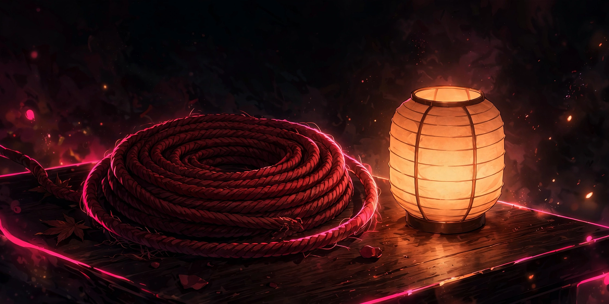

# Idle Hands

## 18+ — Adults Only

This game contains adult content. It is intended only for players 18 and older.

### Content notes

- Set in a rope room, with rope handling and rope coiling as part of her idle behaviour
- A companionship-and-neglect dynamic: leaving her unseen changes how she sits and how she greets your next visit
- Quiet, watchful play built around looking, waiting, and responding to her attention

All characters depicted are adults.

## A companion idle game where you watch Yui, click what catches her eye, and keep her company before loneliness fills the room.

<a href="https://github.com/NTRanch/idle-hands">GitHub</a> · <a href="https://github.com/NTRanch/idle-hands/blob/main/LICENSE.md">License</a> · <a href="https://ntranch.itch.io">itch.io studio page</a>

## Built with

 

## What you do

Yui waits in her rope room. She breathes, blinks, and looks at things — the window, the rope, her hands, you. When her look settles on something, you click it to connect with her. Attention is the whole game: respond to where she is looking, and the room stays warm.

Leave her unseen and loneliness changes how she sits — and it carries over, so it also changes how she greets your next visit. Later levels test your memory and your staying power: repeat the order of rope coils she shows you, then simply stay with her while the room pulls her attention thin.

## Features

- Three levels: First Visit (make 8 connections before loneliness fills the room), Rope Practice (repeat three rope-coil sequences back in order), and The Long Quiet (stay with her for 150 seconds)
- She remembers being left alone — her loneliness and your visit count persist in the browser between sessions
- Settings for room motion and text size are reachable before any play

## Media

- [Level 1 preview](../docs/previews/level-1-idle-hands.mp4)
- [Level 2 preview](../docs/previews/level-2-idle-hands.mp4)
- [Level 3 preview](../docs/previews/level-3-idle-hands.mp4)

## Controls

| Action | Keys |
| --- | --- |
| Connect with what she is looking at / select a rope coil | Click |

## Status

**v1.0.0** — complete. Built for the Torogao Jam Program (a 14-week, one-game-per-week programme) for the Gameotron jam on itch.io. This GitHub page is the game's home while itch project slots are unavailable. To play, open `web/index.html` in a browser — it is one self-contained file and runs fully offline. Free to play.

## Credits

A Nice Thoughts Ranch game.

Made with Odin.
